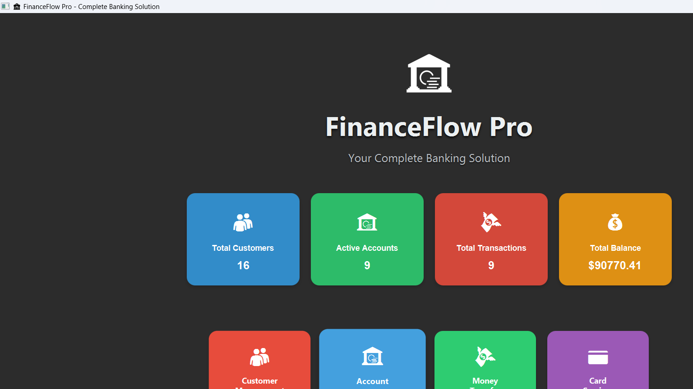

# 🏦 FinanceFlow Pro — Banking Management & Testing System

A Java banking management system built as a **software testing coursework project**. It pairs a full JavaFX + SQLite desktop application with a comprehensive JUnit test suite (unit tests and white‑box tests) covering the domain model: accounts, transactions, cards, loans, investments, employees, offices, and the asset repository.


## Screenshot



## What's in this repo

This project was originally two separate folders — a plain-Java domain model with a JUnit test suite, and a full JavaFX/SQLite application that had evolved from the same model classes — which have been merged into one project:

- **`com.bank.model`** — the domain model (`Account`, `Transaction`, `Card`, `Customer`, `Employee`, `Loan`, `Investment`, `Office`, `Asset`, `Repository`) exercised by **43 unit and white-box tests**.
- **`com.bank.database`** — `DatabaseManager`, a SQLite-backed data layer (customers, accounts, cards, loans, investments, employees, offices, transactions).
- **`com.bank.service`** — `BankingService`, validation and business-logic layer, covered by **11 service-level tests**.
- **`com.bank.gui`** — the JavaFX desktop UI (`ComprehensiveMainController`), a 9-tab interface: Dashboard, Customers, Accounts, Cards, Loans, Investments, Transactions, Employees, Reports.

## Requirements

- **JDK 17+** (verify with `java -version`)
- **Apache Maven 3.6+** (verify with `mvn -version`)

JavaFX and SQLite are pulled in automatically by Maven — no separate install needed.

## Running it

```bash
git clone https://github.com/hassanxadel/Testing-Banking-System.git
cd Testing-Banking-System

# Run the desktop app
mvn javafx:run
```

On Windows you can also just double-click **`run-banking-system.bat`**, which checks your Java install, builds the project, and launches the app.

To build a standalone jar:

```bash
mvn clean package
java -jar target/Bank-1.0.0.jar
```

The app ships with a seeded `bank.db` (sample customers, accounts, cards, a loan, and an investment) so the dashboard has data to show on first launch.

## Running the tests

```bash
mvn test
```

This runs 54 tests across 14 classes:

- 11 service-layer tests (`BankingSystemTest`) — validation rules and `DatabaseManager` smoke tests.
- 43 domain-model tests across `AccountTestSuite`, `AccountWhiteBoxTesting`, `AssetTestSuite`, `CardTestSuite`, `CustomerTestSuite`, `EmployeeTestSuite`, `InvestmentTestSuite`, `LoanTestSuite`, `OfficeTestSuite`, `RepositoryTestSuite`, `RepositoryWhiteBoxTesting`, `TransactionTestSuite`, `TransactionWhiteBoxTesting`.

The white-box suites specifically target boundary conditions on balances, insufficient-funds rejection, and transaction acceptance logic.

## Project structure

```
.
├── pom.xml
├── bank.db                      # seeded sample SQLite database
├── run-banking-system.bat       # one-click Windows launcher
├── src/main/java/com/bank/
│   ├── BankingApplication.java  # JavaFX entry point
│   ├── database/DatabaseManager.java
│   ├── gui/ComprehensiveMainController.java
│   ├── gui/MainController.java  # fallback UI
│   ├── model/                   # Account, Transaction, Card, Customer, ...
│   └── service/BankingService.java
├── src/main/resources/
│   ├── css/banking-style.css
│   └── fxml/main.fxml
└── src/test/java/com/bank/
    ├── BankingSystemTest.java
    └── model/                   # ported unit + white-box test suites
```

## Notes on the restore

See [RESTORE_NOTES.md](RESTORE_NOTES.md) for the full list of bugs fixed, the two-project merge decisions, and dependency changes made while bringing this project back to a clean, working state.

## License

Open source, for educational use.
